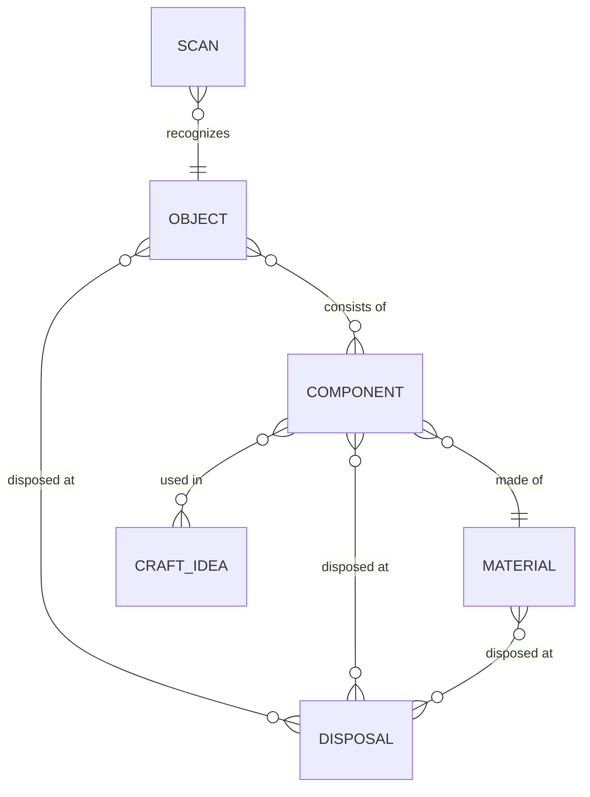

| Entity | Meaning |
|---|---|
| Scan | A recognition of an object and how sure the app is about it |
| Object | A thing you can scan, e.g. a PET bottle |
| Component | A part of an object, e.g. the cap, with a tip on how to remove it |
| Material | What a component is made of, e.g. PET, with recyclability, CO₂e and treatment |
| Craft Idea | Something you can make from components, with instructions |
| Disposal | A place with an address where objects, components or materials can be dropped off |
